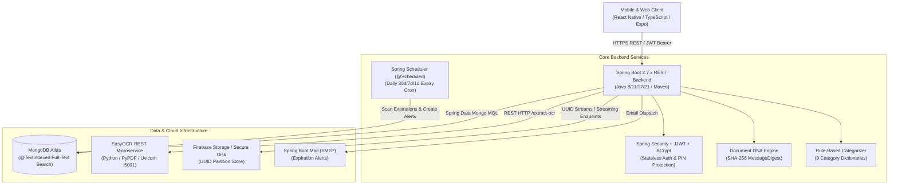
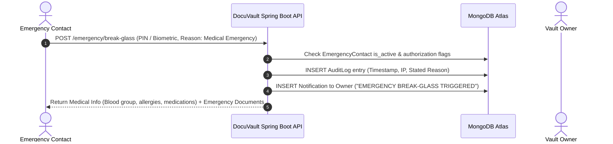

# DocuVault — System Architecture & Security Design

## 1. System Overview

**DocuVault** is an enterprise-grade smart digital document locker and family emergency vault engineered for privacy, cryptographic accountability, and rapid emergency retrieval.

The entire platform is built according to the official **Academic & Architectural Technology Matrix**:



---

## 2. Project Technology Matrix (Academic & Architectural Specification)

| Module / Feature | Technology / Framework | Language | Specification Details |
| :--- | :--- | :--- | :--- |
| **Mobile Application** | React Native | JavaScript / TypeScript | Cross-platform mobile & web client |
| **User Interface** | React Native Components, React Navigation | JavaScript | Glassmorphic design system, Tab navigation |
| **Backend** | Spring Boot 2.7.x | Java | RESTful microservice architecture |
| **Database** | MongoDB Atlas | MongoDB Query Language | Scalable document store with `@TextIndexed` search |
| **Authentication** | Spring Security + JWT | Java | Stateless HMAC-SHA256 JWT tokens |
| **Password Security** | BCrypt | Java | Salted hashing (`BCryptPasswordEncoder`) |
| **OCR** | EasyOCR | Python | Neural OCR engine with PyPDF text extraction |
| **OCR Integration** | REST API (Spring Boot ↔ Python) | Java + Python | Synchronous HTTP microservice on port 5001 |
| **Cloud Storage** | Firebase Storage | Cloud | Secure document bucket with UUID keys |
| **Push Notifications** | Firebase Cloud Messaging (FCM) | Cloud | Real-time push notification adapter |
| **Email Notifications** | Spring Boot Mail | Java | SMTP document expiry alerts (`JavaMailSender`) |
| **Voice Search** | React Native Voice / Speech-to-Text | JavaScript | Web Speech API real-time microphone queries |
| **Text Search** | MongoDB Text Search | Java + MongoDB | Full-text indexing across title, issuer, notes, OCR |
| **Document DNA Verification** | SHA-256 Hashing | Java | Bit-level file fingerprinting (`MessageDigest`) |
| **Category Suggestion** | Rule-Based Keyword Matching | Java | Multi-pattern regex engine across 9 categories |
| **Quick PIN** | Spring Boot + MongoDB | Java | Salted 4-digit PIN with biometric fallback |
| **Document Viewer** | React Native PDF Viewer | JavaScript | Embedded PDF preview and image rendering |
| **Expiry Reminder Scheduler** | Spring Scheduler | Java | Daily `@Scheduled` cron for 30d/7d/1d alerts |
| **REST APIs** | Spring Boot REST | Java | Standardized `{ success, message, data }` responses |
| **API Testing** | Postman | — | Automated collection (`DocuVault_Postman_Collection.json`) |
| **Version Control** | Git & GitHub | Git | Branching, tags, and automated workflows |
| **IDE (Frontend)** | VS Code | — | TypeScript & React Native development |
| **IDE (Backend)** | IntelliJ IDEA / Eclipse | — | Spring Boot Java development |
| **IDE (OCR)** | VS Code | — | Python microservice development |
| **Backend Deployment** | Render | Cloud | Native Docker & Spring Boot web service |
| **Database Deployment** | MongoDB Atlas | Cloud | Multi-cloud global database cluster |
| **File Storage** | Firebase Storage | Cloud | Private bucket storage with download tokens |

---

## 3. Component Architecture

### 3.1 Mobile Application Layer (`/mobile`)
- **Framework**: React Native with Expo and React Native Web.
- **State Management**: TanStack Query (React Query v5) with caching, optimistic updates, and automatic query invalidation.
- **Authentication**: JWT access tokens stored client-side with automatic Bearer token injection and session expiry listener.
- **Security Interceptor**: In-app biometric and Quick PIN lock overlay for protecting active sessions upon return.
- **Styling**: Curated design system featuring Deep Navy (`#0A192F`), Slate card surfaces (`#0F2444`, `#132B52`), restrained Teal accents (`#0D9488`), and dynamic Dark/Light mode theme tokens.
- **Voice Search**: Real-time microphone capture via Web Speech API / React Native Voice feeding into reactive document search filters.

### 3.2 Backend Application Layer (`/backend-spring-boot`)
- **Engine**: Java 8/11/17/21 running Spring Boot 2.7.x with Spring MVC and embedded Apache Tomcat.
- **Security & Cryptography**: Spring Security filter chain with custom `JwtAuthenticationFilter`, `io.jsonwebtoken` (JJWT) token signing, and `BCryptPasswordEncoder`.
- **Data Layer**: Spring Data MongoDB repositories (`MongoRepository`) with fluent querying, text indexing, and projection support.
- **Background Scheduler**: Spring Scheduler (`@Scheduled`) cron worker running daily scans for expiring documents at 30, 7, and 1-day thresholds.
- **Response Format**: Unified REST envelope across all controllers:
  ```json
  {
    "success": true,
    "message": "Operation completed successfully",
    "data": { ... }
  }
  ```

### 3.3 EasyOCR Microservice Layer (`/backend-spring-boot/ocr-service-python`)
- **Engine**: Python 3.10+ running Uvicorn and FastAPI on port `5001`.
- **Text Extraction**: EasyOCR neural model for scanned image analysis combined with `pypdf` for native digital PDF vector text extraction.
- **Spring Boot Integration**: Spring Boot's `OcrIntegrationService` makes synchronous HTTP multipart POST requests to `http://localhost:5001/extract-ocr`. If the microservice is offline, an internal Java fallback continues processing without interrupting uploads.

### 3.4 Storage Layer & File Isolation
- **Private File System**: Uploaded files are strictly stored outside public web roots.
- **Non-Guessable Storage Keys**: Stored as cryptographically random UUIDv4 names (e.g., `8f4b23a1-7c9e-4b21-9876-543210fedcba.pdf`) with sanitized extensions, completely preventing directory traversal attacks.
- **Streaming Endpoints**: Direct disk paths are never exposed. Documents are streamed exclusively through authorized endpoints (`/documents/{id}/download` and `/documents/{id}/preview`) after database permission verification.
- **Cloud Backend**: Seamlessly configurable with Firebase Storage buckets via `FirebaseApp` initialization.

---

## 4. Core Subsystems

### 4.1 Role-Based Access Control (RBAC) Matrix

| Role | Vault View | Upload Documents | Invite Members | View Shared Docs | Emergency Access |
|---|:---:|:---:|:---:|:---:|:---:|
| **Vault Owner** | Full | Yes | Yes | Full | Full Config |
| **Family Admin** | Shared | Yes | Yes | Explicitly Shared | Configurable |
| **Family Member** | Shared | Yes (Personal) | No | Explicitly Shared | No |
| **Emergency Contact** | Emergency Only | No | No | No | Verified Break-Glass |

---

### 4.2 Time-Bounded QR-Code Sharing Flow
1. **Creation**: The document owner specifies the document, expiration interval (1h, 24h, 7d), maximum view count (e.g. 1 view "burn after reading"), and an optional 4-digit PIN.
2. **Token Generation**: Spring Boot generates a high-entropy URL-safe token (`UUID.randomUUID().toString()`) and renders a ZXing Base64 QR code image.
3. **Recipient Scan**: Scanning opens `/share/{token}` or the in-app QR scanner.
4. **Validation**: The backend validates:
   - Token exists and `is_revoked == false`
   - `now() < expires_at`
   - `access_count < max_access_count`
   - Matching PIN if protected (verified via BCrypt)
5. **Access & Audit**: Increments `access_count`, logs recipient IP and timestamp in `share_access_logs`.

---

### 4.3 Emergency Vault Access Flow ("Break-Glass Protocol")



---

### 4.4 All-Type Document Storage Taxonomy
Documents are organized into 9 first-class operational categories:
1. **Identity**: National IDs, Passports, Aadhaar, Voter IDs, PAN cards.
2. **Education**: University degrees, transcripts, diplomas, certificates.
3. **Medical**: Clinical records, prescription summaries, vaccination cards.
4. **Financial**: Bank statements, salary certificates, tax filings, Form 16.
5. **Legal**: Sale deeds, notarized affidavits, contracts, power of attorney.
6. **Insurance**: Health floater policies, vehicle insurance, term life policies.
7. **Property**: Conveyance deeds, title records, lease agreements, khata.
8. **Vehicle**: Driving licences, RC registration books, PUC certificates.
9. **Other**: Municipal receipts, utility records, miscellaneous files.

---

### 4.5 Personal vs Family Locker Isolation
- **Personal Locker**: Private to the individual user; strictly inaccessible to other family members.
- **Family Locker**: Shared assets accessible by all authenticated members of a family group (e.g. home deeds, family health insurance).
- **Isolation Mechanism**: Instant in-app switcher filtering documents by the `is_family_vault` flag while preserving unified text and voice search indexing.

---

### 4.6 Cryptographic Document DNA Verification (SHA-256 Hashing)
- **Upload Hashing**: During file upload, Java's `MessageDigest.getInstance("SHA-256")` computes a 64-character hexadecimal digest representing the file's cryptographic DNA.
- **Integrity Auditing**: The `/documents/{id}/verify-dna` endpoint recalculates the SHA-256 hash directly from physical or cloud storage and verifies it against the original database fingerprint.
- **Tamper Detection**: Instantly returns `VERIFIED_AUTHENTIC` or `TAMPER_DETECTED`, exposing corruption or unauthorized storage tampering.

---

### 4.7 OCR Text Extraction & Rule-Based Categorization
- **EasyOCR REST Service**: Scanned files (PNG, JPG, PDF) are processed through the Python EasyOCR microservice on port 5001.
- **Rule-Based Engine**: Java's `CategorySuggestionService` analyzes extracted text against 9 domain dictionaries to automatically suggest the most accurate category with confidence scoring.
- **Full-Text Indexing**: Extracted OCR text is stored in MongoDB Atlas with `@TextIndexed` annotations for rapid sub-second queries.

---

### 4.8 Emergency Vault & Quick PIN Biometric Fallback
- **Break-Glass Access**: Emergency contacts access critical medical cards and emergency-tagged documents upon submitting a valid reason.
- **Quick PIN Fallback**: When biometrics (fingerprint/Face ID) are unavailable or fail, users authenticate using a secure 4-digit Quick PIN (`/auth/quick-pin` and `/auth/verify-pin`) hashed with BCrypt.

---

### 4.9 Voice-Based Document Search
- **Web Speech API**: Real-time microphone speech recognition converts spoken document titles, issuers, or categories into search queries.
- **Multi-Field Querying**: Matches spoken voice transcripts against document titles, issuer names, notes, and full OCR extracted text with instant visual feedback.
